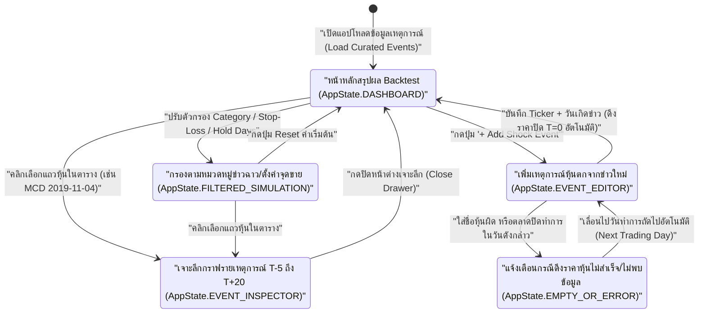

# Irrational Selloff Rebound Backtester

An event-driven quantitative backtesting workspace that measures short-term mean-reversion rebounds after the market punishes a stock for **non-fundamental headline shocks** (e.g., CEO personal scandals/affairs, viral PR gaffes, podcast/tweet panics, or knee-jerk sympathy dumps) where underlying cash flows and operations remain intact.

---

## 1. Thesis & Strategy Mechanics

Markets routinely overreact in the first 24 hours (`T=0`) to sensational headlines due to algorithmic headline-scraping, institutional headline-risk dumping, and retail panic. When the shock is **non-structural** (no accounting fraud, no balance-sheet insolvency, no core product obsolescence):

1. **Entry Rule (`T=0 Close`):** Buy at the closing price of **Day 0** (the trading day the headline shock punishes the stock, or first trading session after an after-hours announcement).
2. **Holding Horizons:** Evaluate post-entry cumulative returns and benchmark-adjusted excess returns (`Alpha vs. SPY`) across **`T+1`, `T+3`, `T+5`, `T+10`, and `T+20` trading days**, plus dynamic **Gap-Fill %** (`50%` / `100%` recovery of the pre-shock close `T-1`) and **Stop-Loss / Take-Profit** triggers.
3. **Control Filter:** Compare each stock's rebound against the S&P 500 (`SPY`) over the identical window to isolate idiosyncratic recovery from broad market beta.

---

## 2. Initial Curated Event Catalog (Antigravity Manual Research Dataset)

The dataset is manually researched and categorized into non-fundamental shock archetypes:

| Event ID | Ticker | Company | Shock Date (`T=0`) | Category | Headline Trigger (Why the Market Panicked) | Why It Made No Fundamental Sense |
| :--- | :--- | :--- | :--- | :--- | :--- | :--- |
| `EVT-001` | `MCD` | McDonald's | `2019-11-04` | `CEO_AFFAIR` | CEO Steve Easterbrook ousted over consensual relationship policy violation (`-2.7%` gap down). | Global franchise cash flows and same-store sales momentum were completely unchanged. |
| `EVT-002` | `HPQ` | HP Inc. | `2010-08-09` | `CEO_AFFAIR` | CEO Mark Hurd resigned over personal relationship & expense investigation (`-8.3%` drop). | HP simultaneously raised full-year revenue and EPS guidance on the exact same announcement. |
| `EVT-003` | `INTC` | Intel | `2018-06-21` | `CEO_AFFAIR` | CEO Brian Krzanich resigned over past consensual relationship with an employee (`-2.4%` drop). | Intel raised Q2 revenue and EPS guidance alongside the resignation press release. |
| `EVT-004` | `TSLA` | Tesla | `2018-09-07` | `EXEC_BEHAVIOR` | Elon Musk smoked cannabis on Joe Rogan podcast + executive departure headlines (`-6.3%` drop). | Model 3 production ramp and customer demand were completely unaffected; rebounded `+14.8%` in 5 days. |
| `EVT-005` | `NKE` | Nike | `2018-09-04` | `PR_BACKLASH` | Viral social-media boycott panic over 30th Anniversary ad campaign (`-3.2%` selloff). | Core demographic online sales surged `+31%` over the same weekend; stock hit new highs within 10 days. |
| `EVT-006` | `SBUX` | Starbucks | `2018-04-16` | `PR_BACKLASH` | Viral store arrest controversy & nationwide store closure for training (`-2.2%` dip). | Loyal customer habits and unit economics remained untouched; full recovery within 2 weeks. |
| `EVT-007` | `LULU` | Lululemon | `2013-12-10` | `EXEC_GAFFE` | Founder Chip Wilson's controversial TV interview remarks & chairman step-down shock. | Brand cult following and store productivity remained industry-leading. |
| `EVT-008` | `COST` | Costco | `2017-06-16` | `SYMPATHY_PANIC` | Amazon announced acquisition of Whole Foods; market dumped Costco (`-7.2%` in 1 day). | 90%+ Costco membership renewal rate and bulk warehouse pricing moat had near-zero overlap with Whole Foods. |
| `EVT-009` | `LLY` | Eli Lilly | `2022-11-11` | `FAKE_NEWS_SHOCK` | Fake verified Twitter account tweeted "Insulin is now free" (`-4.5%` drop wiping `$15B+` market cap). | Literally a prank tweet with zero legislative or pricing reality behind it. |
| `EVT-010` | `LMT` | Lockheed Martin | `2022-11-11` | `FAKE_NEWS_SHOCK` | Fake verified Twitter account claimed halt of weapons sales (`-5.5%` intraday drop). | Multi-decade Pentagon defense contracts cannot be canceled by a parody tweet. |

---

## 3. Architecture & Battle-Tested Open-Source Stack

Following the **"Ponytail" Ultra-Minimalist Philosophy**, this repository wraps battle-tested open-source libraries rather than reinventing financial math or UI primitives:

- **Market Data & OHLCV Fetching:** [`yfinance`](https://github.com/ranaroussi/yfinance)
- **Backtesting & Vectorized Event Windows:** [`backtesting.py`](https://github.com/kernc/backtesting.py) & [`pandas`](https://github.com/pandas-dev/pandas)
- **Portfolio Tear-Sheets & Risk Metrics:** [`quantstats`](https://github.com/ranaroussi/quantstats)
- **Backend API & Data Validation:** [`FastAPI`](https://github.com/fastapi/fastapi) + [`Pydantic`](https://github.com/pydantic/pydantic)
- **Python Package & Lint Tooling:** [`uv`](https://github.com/astral-sh/uv) + [`Ruff`](https://github.com/astral-sh/ruff)
- **Frontend UI & State:** [`shadcn/ui`](https://github.com/shadcn-ui/ui) + [`Radix Primitives`](https://github.com/radix-ui/primitives) + [`Lucide Icons`](https://github.com/lucide-icons/lucide) + [`TanStack Query`](https://github.com/TanStack/query) + [`Zustand`](https://github.com/pmndrs/zustand)
- **Typography & Editorial Tokens (Anthropic Design System):**
  - Headings: [`Newsreader`](https://github.com/productiontype/Newsreader)
  - UI & Controls: [`Inter`](https://github.com/rsms/inter)
  - Financial Tickers & Tabular Data: [`JetBrains Mono`](https://github.com/JetBrains/JetBrainsMono)
  - Palette: Warm Alabaster (`#FAF9F5` / `#F4F1EA`), Deep Charcoal (`#141413`), Muted Stone (`#666560`), Terracotta Accent (`#D97757` / `#C6613F`), Crisp Borders (`#E5E2DC`).

---

## 4. Visual User Flow & State Machine



---

## 5. Planned Repository Structure

```text
irrational-selloff-backtest/
├── README.md                  # Architectural blueprint, event catalog, and citations
├── data/
│   ├── events_catalog.json    # Curated non-fundamental shock dataset
│   └── ohlcv_cache.json       # Local price cache (-5d to +20d around each shock)
├── backend/
│   ├── main.py                # FastAPI server + backtest simulation endpoints
│   └── engine.py              # T=0 close entry & multi-horizon rebound calculator
└── frontend/
    └── index.html             # Anthropic Editorial interactive dashboard
```
